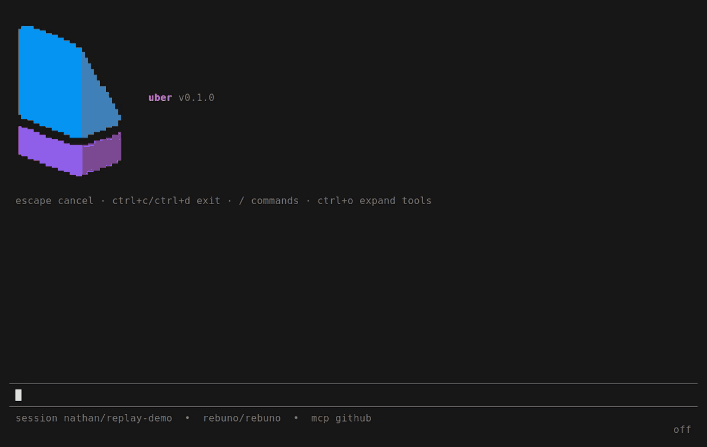
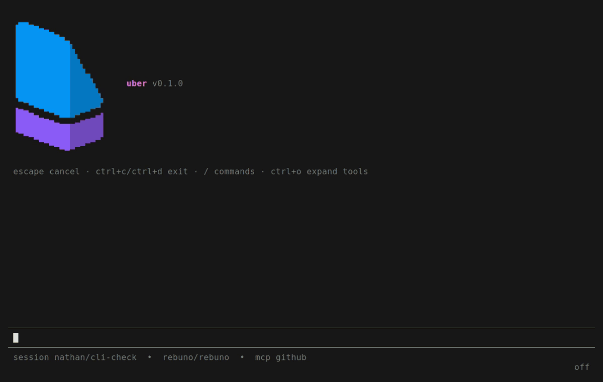

# Uber


A governed cloud coding agent for teams, built on
[Pi](https://github.com/earendil-works/pi) and running on
[Rebuno](https://github.com/rebuno/rebuno).

## Quickstart

Set a model provider's API key and `GITHUB_TOKEN` in the environment or in
`.env`, with `REBUNO_AGENT_SECRET=uber-secret` to match `rebuno.yaml`, then
start the kernel and the agent:

```bash
pnpm install
rebuno dev --config rebuno.yaml
pnpm start
```

Open a session from a clone of the repository to work on:

```bash
npm install -g @rebuno/uber
uber
```

## Pi extensions

Pi packages install as they do in pi. Installed in the agent's config, their
tools run as recorded steps under policy, and a session turns optional ones on
with `/extensions`. Installed in your own pi configuration as well, the client
draws their calls with the extension's renderers. See
[Extensions](https://docs.rebuno.io/uber/configuration#extensions) for how they
run on the agent:



## Themes

The client uses your pi themes, built in or from a package, and `/settings`
switches between them:


## Documentation

See [docs.rebuno.io/uber](https://docs.rebuno.io/uber/overview).
